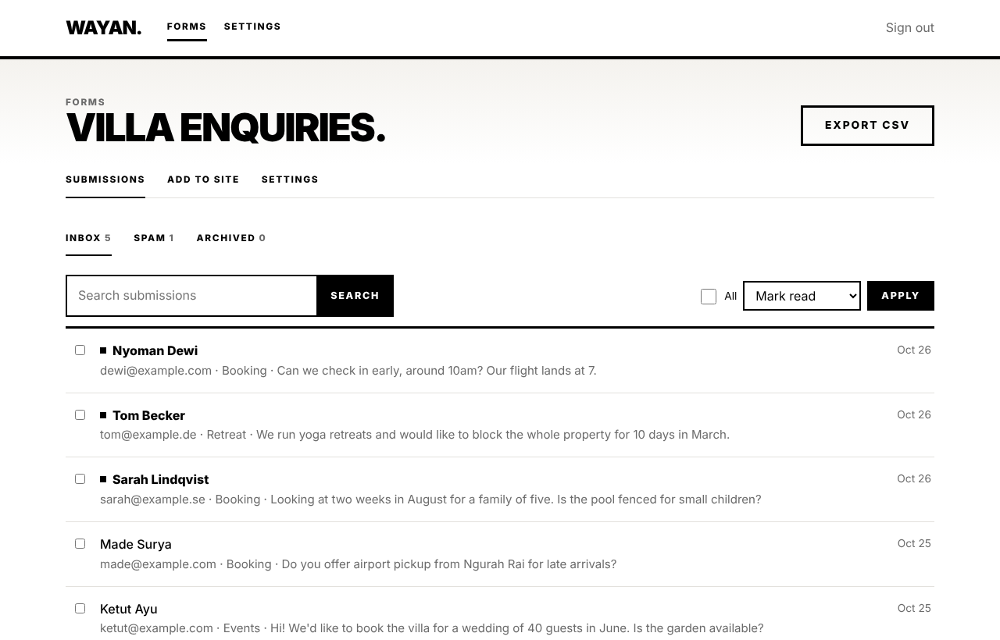
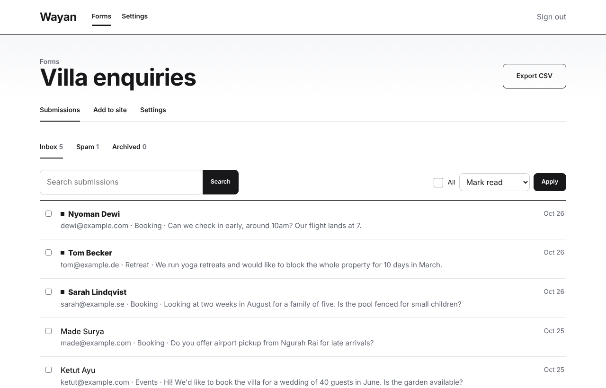
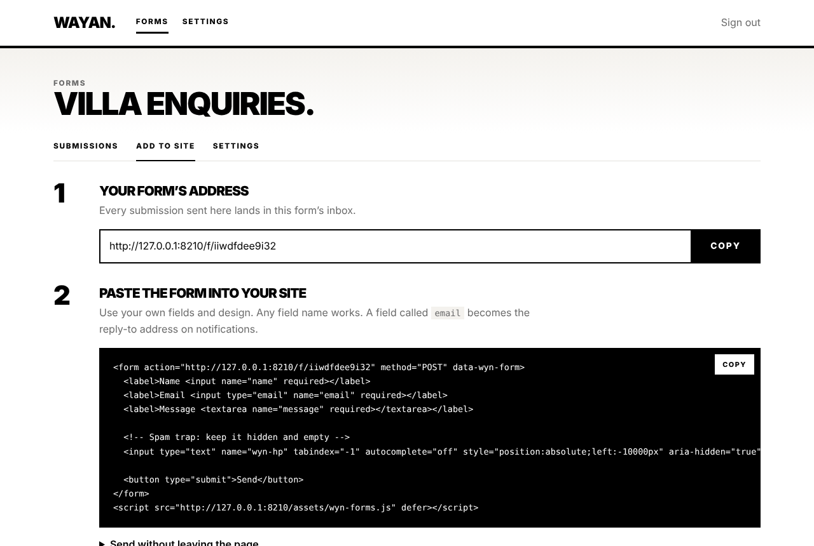

# Wyn Forms

**A self-hosted form backend.** Point any HTML form at your own server and get a spam-filtered inbox, email and chat notifications, file uploads and CSV export. It works with static sites, landing pages and anything else that can POST.

PHP 8.2 and SQLite. No Composer packages and no database server. Upload it to any PHP host, or run it with Docker.





## Why

Hosted form services charge per submission and keep your visitors' messages on their servers. Wyn Forms is one small app you own: unlimited forms, unlimited submissions, and data that stays in a single file on your server.

## Features

- **Works with any form:** plain HTML POST, AJAX with `fetch`, or JSON from another server. Checkbox groups, multi-line text and file attachments are all supported.
- **Layered spam filtering:**
  - A hidden honeypot field.
  - A time-on-page trap.
  - A per-visitor rate limit.
  - A link and markup check.
  - An allowed-sites list.
  - Optional Cloudflare Turnstile or hCaptcha.

  Spam goes to a Spam folder, and bots still see "thanks", so they don't learn to adapt.
- **Notifications:** email (SMTP, with Reply-To set to the visitor), Slack, Discord, Telegram, and HMAC-signed webhooks. Notifications are sent after the visitor's response, so the form never feels slow.
- **Inbox:** unread markers, search, Inbox / Spam / Archived folders, bulk actions, one-click "Reply by email", and a delivery log per submission.
- **CSV export:** Excel-friendly UTF-8, with formula injection neutralised.
- **Private by design:**
  - Visitor IPs are stored only as salted hashes.
  - Uploads live outside the web root under random names and are always downloaded, never shown inline.
  - Old spam is deleted automatically.



## Quick start

### Docker

```bash
git clone https://github.com/wayancc/wyn-forms && cd wyn-forms
docker compose up -d
```

Open `http://localhost:8080/admin`, create your account, and make a form.

### Shared hosting (cPanel, Plesk)

1. Upload the folder and point the domain (for example `forms.example.com`) at `public/`.
2. Make sure `storage/` is writable by PHP.
3. Open `/admin`, create your account, and make a form.

No cron jobs are needed.

### Try it locally

```bash
php bin/wyn-forms serve      # http://127.0.0.1:8000/admin
```

## Add a form to your site

```html
<form action="https://forms.example.com/f/abc123def456" method="POST" data-wyn-form>
  <input name="name" required>
  <input type="email" name="email" required>
  <textarea name="message" required></textarea>

  <!-- Spam trap: keep it hidden and empty -->
  <input type="text" name="wyn-hp" tabindex="-1" autocomplete="off" style="position:absolute;left:-10000px" aria-hidden="true">

  <button type="submit">Send</button>
</form>
<script src="https://forms.example.com/assets/wyn-forms.js" defer></script>
```

- **The script is optional.** It adds the honeypot automatically and enables the time trap.
- **Stay on the page:** add `data-wyn-ajax` to send without a page change. The result appears in `[data-wyn-status]`, and the form fires `wyn:success` and `wyn:error` events.
- **Control fields:** `wyn-subject` sets the email subject. `wyn-next` sets a custom redirect, which must point to one of your allowed sites.

### From JavaScript or a server

```js
const wynRes = await fetch('https://forms.example.com/f/abc123def456', {
  method: 'POST',
  headers: { 'Content-Type': 'application/json', Accept: 'application/json' },
  body: JSON.stringify({ name: 'Ada', email: 'ada@example.com', message: 'Hello' }),
});
// → { "ok": true, "message": "Thanks! Your message has been sent.", "id": 42 }
```

Errors return `ok: false`, a readable `message`, and a status code:

| Status | Meaning |
| --- | --- |
| `403` | Site not allowed, or CAPTCHA failed |
| `410` | Form closed |
| `413` | File too large |
| `422` | Empty submission |
| `429` | Rate limit reached |

If you set allowed sites, server-to-server requests must send an `Origin` header for one of them.

## Webhook payload

```json
{
  "event": "submission",
  "form": { "id": 1, "key": "abc123def456", "name": "Contact form" },
  "submission": {
    "id": 42,
    "created_at": "2026-10-28T13:22:40+00:00",
    "fields": { "name": "Ketut Ayu", "email": "ketut@example.com", "message": "Hello" },
    "files": [{ "name": "brief.pdf", "size": 182044, "type": "application/pdf" }]
  }
}
```

If you set a secret, the request carries `X-Wyn-Signature: sha256=<HMAC of the body>`.

## Command line

```
php bin/wyn-forms forms                       List forms and their keys
php bin/wyn-forms cleanup                     Delete old spam now (it also runs daily on its own)
php bin/wyn-forms user:password --email=…     Reset a password
php bin/wyn-forms serve                       Local dev server
```

## Design

Two looks, switched under **Settings → Look**:

- **Bold** (default), based on [wayan.cc](https://wayan.cc): black on white, heavy uppercase Inter headlines, square corners and thick rules. Big type is kept for public pages and empty states; working screens use compact headings.
- **Neutral:** quieter type and rounded corners, for teams who want it to sit beside their own brand.

Every color, font and border width lives in `public/assets/wyn-tokens.css`.

The Inter font is bundled (SIL Open Font License), so neither the dashboard nor your visitors' thank-you page makes any request to Google or another third party.

All CSS classes, data attributes, control fields, JS names and database tables use the `wyn-` prefix (`wyn_` in SQL), so nothing clashes with your site.

## Development

```bash
php tests/run.php     # 57 checks, no dependencies, no internet
```

## Roadmap

- [ ] Autoresponder email to the visitor
- [ ] Per-form JSON API with tokens
- [ ] Field validation rules (required, email, max length)
- [ ] Multiple users
- [ ] Zapier/Make-friendly polling endpoint

## License

[AGPL-3.0](LICENSE) for the app. You can self-host it freely, including commercially; if you offer a modified version as a service, you must share your changes.

`public/assets/wyn-forms.js`, the script you embed on your websites, is MIT licensed, so embedding it never affects your own site's code.
